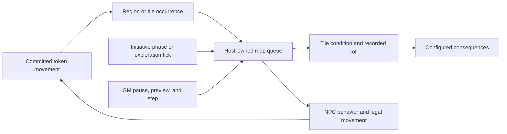

# Single-map automation roadmap

25 additional issue drafts in [Nav1212/maptool](https://github.com/Nav1212/maptool), based on source `ee0f937c73`. These are roadmap capabilities; [implementation progress](IMPLEMENTATION.md) records the tested engine foundations and remaining integration work.

## Intended play loop

A player moves onto an authored tile. The map runtime evaluates a configured check once, records the roll and audience, and runs its pass/fail actions. NPC controllers consume the same map time and committed events to patrol, investigate, or take a turn. The GM can pause, preview, step, or override the result.

## First playable slice

1. Pin the encounter to one map and create the shared runtime: MAPAUTO-1 and MAPAUTO-2.
2. Reuse SCENE-3/SCENE-4 for authored geometry and committed movement events; add tile conditions, rolls, and consequences.
3. Add legal NPC movement and waypoint patrol, sharing the map clock and existing topology/pathfinding.
4. Expose GM control and checkpoints, then ship the small starter scenario from MAPAUTO-5.
5. Add richer tile recipes, repeat policies, perception, behavior rules, and encounter authoring tools incrementally.

## Defaults and boundaries

- Rules remain configurable through a small map-local adapter backed by current token properties, dice, and trusted MTScript.
- NPC decisions use authored routes and explicit conditions/actions. No external AI/LLM service is required.
- Logical map time, turn phases, activation receipts, and stored outcomes prevent client refreshes from rerunning accepted actions.
- Use tile/region geometry without assuming every map is a square grid; each ticket states supported geometry and movement behavior.
- Existing multi-map campaigns and manual movement remain available; the new workspace is opt-in.
- Shared clocks, persistence, GM controls, and the existing region dispatcher are reused across tiles and NPCs rather than creating separate competing runtimes.

## New tickets

| ID | Issue | Priority | Dependencies |
|---|---|---|---|
| MAPAUTO-EPIC | [[Epic]: Specialize the engine for a reusable single-map automated encounter](issues/MAPAUTO-EPIC.md) | P1 | — |
| MAPAUTO-1 | [[Feature]: Add a focused single-map encounter workspace and reusable encounter package](issues/MAPAUTO-1.md) | P1 | — |
| MAPAUTO-2 | [[Feature]: Add an authoritative map clock and deterministic automation queue](issues/MAPAUTO-2.md) | P1 | MAPAUTO-1, ACCESS-6 |
| MAPAUTO-3 | [[Feature]: Save encounter checkpoints and reset map automation to a chosen baseline](issues/MAPAUTO-3.md) | P2 | MAPAUTO-1, MAPAUTO-2 |
| MAPAUTO-4 | [[Feature]: Give the GM a map automation console with preview, pause, and action history](issues/MAPAUTO-4.md) | P1 | MAPAUTO-2 |
| TILE-EPIC | [[Epic]: Build editable interactive tiles with automatic checks and outcomes](issues/TILE-EPIC.md) | P1 | — |
| TILE-1 | [[Feature]: Bind interactive tiles to map regions and objects through a visual inspector](issues/TILE-1.md) | P1 | SCENE-3, SCENE-4, MAPAUTO-1 |
| TILE-2 | [[Feature]: Automatically roll tile dice, skill checks, and saves using a configurable rules adapter](issues/TILE-2.md) | P1 | TILE-1, TILE-7 |
| TILE-3 | [[Feature]: Configure ordered tile actions for check success, failure, and other outcomes](issues/TILE-3.md) | P1 | TILE-2, TILE-7 |
| TILE-4 | [[Feature]: Control tile repeat, cooldown, and per-token activation policies](issues/TILE-4.md) | P1 | TILE-1, TILE-7, MAPAUTO-2 |
| TILE-5 | [[Feature]: Add editable hazard, pressure-plate, and template-area tile presets](issues/TILE-5.md) | P1 | TILE-2, TILE-3, TILE-4, SCENE-3, SCENE-4, MAPAUTO-2 |
| TILE-6 | [[Feature]: Operate map objects through code-free interact, lock, and state presets](issues/TILE-6.md) | P2 | TILE-1, TILE-2, TILE-3, TILE-4, TILE-7 |
| TILE-7 | [[Feature]: Record authoritative tile rolls and idempotent outcome steps across clients](issues/TILE-7.md) | P1 | TILE-1, SCENE-4, MAPAUTO-2 |
| TILE-8 | [[Feature]: Save reusable tile recipes and extend the starter scenario with tile traces](issues/TILE-8.md) | P2 | TILE-2, TILE-3, TILE-4, TILE-5, TILE-6, TILE-7, MAPAUTO-4, MAPAUTO-5 |
| NPC-EPIC | [[Epic]: Run configurable NPC automation inside one authoritative map runtime](issues/NPC-EPIC.md) | P1 | — |
| NPC-1 | [[Feature]: Add versioned NPC automation profiles and explicit per-map activation](issues/NPC-1.md) | P1 | MAPAUTO-1, ACCESS-6 |
| NPC-2 | [[Feature]: Author NPC waypoint patrols with loops, waits, and blocked-route behavior](issues/NPC-2.md) | P1 | NPC-1, NPC-4, NPC-5 |
| NPC-3 | [[Feature]: Add observer-specific NPC perception and deterministic behavior states](issues/NPC-3.md) | P2 | NPC-1, MAPAUTO-2, SCENE-3 |
| NPC-4 | [[Feature]: Schedule NPC turns and real-time decisions through the shared map clock](issues/NPC-4.md) | P1 | NPC-1, MAPAUTO-2, ACCESS-6 |
| NPC-5 | [[Feature]: Execute NPC movement within budgets, collisions, and live map topology](issues/NPC-5.md) | P1 | NPC-1, SCENE-4, ACCESS-6 |
| NPC-6 | [[Feature]: Choose and execute NPC actions with configurable rules and recorded rolls](issues/NPC-6.md) | P2 | NPC-1, NPC-3, NPC-4, NPC-5, ACCESS-6, TILE-2 |
| NPC-7 | [[Feature]: Extend the GM runtime console with NPC pause, step, override, and decision inspection](issues/NPC-7.md) | P2 | MAPAUTO-4, NPC-2, NPC-3, NPC-4, NPC-6, ACCESS-6 |
| NPC-8 | [[Engineering]: Add deterministic NPC scenario replay and bounded-work regression fixtures](issues/NPC-8.md) | P2 | NPC-2, NPC-3, NPC-5, NPC-6, NPC-7, MAPAUTO-2 |
| NPC-9 | [[Feature]: Let eligible NPCs operate unlocked doors along an authored route](issues/NPC-9.md) | P2 | NPC-5, NPC-6, SCENE-1, SCENE-2, ACCESS-6 |
| MAPAUTO-5 | [[Feature]: Ship a playable single-map starter with tile checks and patrolling NPCs](issues/MAPAUTO-5.md) | P2 | MAPAUTO-3, MAPAUTO-4, TILE-2, TILE-3, NPC-1, NPC-2 |

## Publication

The drafts are included in the shared issues.json manifest and resumable publisher. GitHub API reads work, but Issues is disabled in the repository and the integration cannot enable it. Check the main README and publication.json for the latest confirmed state.
